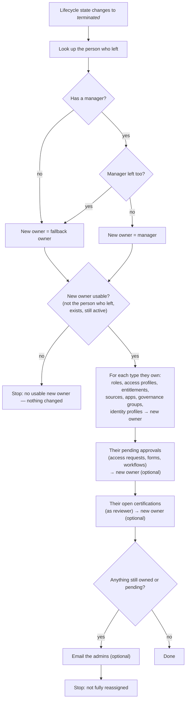

# Reassign Ownership on Termination

A SailPoint Identity Security Cloud (ISC) workflow. When someone leaves the organisation, it moves everything they
own to their **manager**. If there's no usable manager, it moves it to a **fallback owner** you choose. That covers
**roles, access profiles, entitlements, sources, apps, governance groups and identity profiles**, the **approvals
still waiting for them**, and the **certifications they still have to review**. Nothing is left orphaned, so approvals, certifications and access reviews that go to the
owner keep working, and nobody's request waits on someone who has left.

It works in any ISC tenant. Everything organisation-specific is in one config file, or, without Python, in four
clearly marked placeholders.

## What it does



- **Trigger:** *Identity Lifecycle State Changed*, filtered to the states you call terminations (default
  `terminated`).
- **Who becomes the owner:**
  - The person's manager, unless they have none, or the manager is in an inactive state themselves (default
    `terminated` or `archived`).
  - Otherwise the fallback owner.
  - With `ownerStrategy: "fallback-only"`, it's always the fallback owner.
- **What changes:** only the **primary owner** of the object types you enable (all seven by default): roles,
  access profiles, entitlements, sources, apps, governance groups (the group's owner, not its members) and identity
  profiles.
  - Additional owners, governance group *memberships* and workflow owners are not touched (see
    [Adapting it](#adapting-it-to-your-organisation)).
  - Access itself is not touched either. Removing access is the lifecycle state's job.
- **Pending approvals** (`pendingApprovals`, on by default): every access-request, form and workflow approval
  waiting for the person who left is reassigned to the same new owner, with the comment *"Reassigned automatically:
  the approver has left (workflow …)"*. SailPoint records it in the approval's history as a manual reassignment.
  - Only approvals assigned to **them personally** move. An approval assigned to a governance group they're in stays
    with the group.
- **Open certifications** (`pendingCertifications`, on by default): every active, unfinished certification they're
  the reviewer of moves, as a whole, to the same new owner, with the reason *"Reassigned automatically: the reviewer
  has left (workflow …)"* (the campaign's reassign call).
- Manual tasks (work items) are not moved yet.
- **Safety:**
  - The workflow never makes the person who left the owner again.
  - It never patches with an unfilled placeholder.
  - Before changing anything, it checks that the new owner exists and is still active.
  - Afterwards it checks that nothing is left. If something is, the run ends as **Failed** with a clear reason
    (optionally with an email).

## Before you start

| You need | Why |
|---|---|
| An ISC **ORG_ADMIN** | To install the workflow and run its test |
| A **fallback owner**: an identity who isn't leaving | Receives objects when there's no usable manager. It must be an identity: ISC doesn't allow a governance group as the primary owner of these objects |
| A **Personal Access Token** for the workflow, from an ORG_ADMIN, ideally a service identity | The workflow's HTTP steps call the ISC API with it to find and update owners |
| A **Parameter Storage** entry holding that PAT (one-time, in the UI) | The workflow references the credential instead of containing it. See below |
| The termination lifecycle state **enabled** in your identity profiles | Otherwise the trigger never fires. `doctor` checks this |
| For the script route: Python 3.10+ | Standard library only; nothing to install |

### Store the workflow's PAT in Parameter Storage (once per tenant)
1. In ISC, create a PAT (**Preferences → Personal Access Tokens → New Token**) for the identity the workflow
   should act as. Keep its client ID and secret.
2. Go to **Admin → Global → Parameter Storage → Create Parameter** and fill in:
   - **Name:** `Ownership Reassignment API` (or anything; set the same name as `http.parameter` in the config)
   - **Owner:** an admin
   - **Category:** Authentication. **Type:** OAuth 2.0 - Client Credentials Grant
   - **Token URL:** `https://<tenant>.api.identitynow.com/oauth/token` (use your tenant's API host)
   - **Client ID / Client Secret:** from the PAT. **Credential Location:** Header
3. Save. The secret can't be read back, not even through the API.

Why not put the PAT in the workflow? In testing, ISC kept an HTTP step's inline secret readable in the workflow
definition when the step sat inside a loop, and silently dropped it elsewhere. Parameter Storage avoids both, and it
is where SailPoint is taking the HTTP Request action (v3). See [docs/RESEARCH.md](docs/RESEARCH.md).

## Deploy with the script (recommended)

```bash
cp config/ownership.example.json config/<tenant>.json        # then edit it (keys below)
# Credentials for the installer: SAIL_BASE_URL, SAIL_CLIENT_ID, SAIL_CLIENT_SECRET (an ORG_ADMIN PAT),
# in the environment or in the .env file named by envFile. SAIL_BASE_URL is https://<tenant>.api.identitynow.com

python ownership.py doctor --config config/<tenant>.json      # read-only: is this tenant ready?
python ownership.py apply  --config config/<tenant>.json --dry-run
python ownership.py apply  --config config/<tenant>.json      # creates it DISABLED
python ownership.py test   --config config/<tenant>.json --departed <test identity>
#   add --pending-for <another test identity> to also give the departed identity real pending work: two approvals
#   (one assigned to them, one to a governance group they're in; only the first may move) and a test certification
#   they review (a throwaway campaign, no emails). Takes 5-15 minutes.
python ownership.py apply  --config config/<tenant>.json --enable
```

| Command | What it does |
|---|---|
| `doctor` | Read-only checks: the installer PAT is ORG_ADMIN, the parameter exists with the right token URL, the trigger and actions exist, the trigger filter matches, the lifecycle states exist and are enabled, the fallback owner resolves and is active, the APIs answer |
| `apply [--dry-run] [--enable]` | Creates or updates the workflow (looked up by name). It stays disabled unless you pass `--enable`. Updates keep the existing parameter links |
| `test --departed <id\|username\|email>` | Runs the **disabled** workflow through ISC's test endpoint, pretending that identity was terminated. It first creates one throwaway object of every type, owned by them: a flat-file source, an entitlement loaded on it, an access profile, a role, a governance group, an identity profile and an app (about a minute, mostly the entitlement load). It checks who owns each afterwards, then deletes them. It refuses to run if the identity already owns anything. `--no-objects` checks the "owns nothing" path. `--history` prints the run's steps |
| `status` | Shows whether it's enabled, its trigger, and recent runs |
| `uninstall [--yes]` | Disables and deletes the workflow. Ownership changes it made stay |
| `export [--out FILE]` | Writes the workflow JSON with placeholders (the committed file in `workflow/`) |

### Config keys (`config/<tenant>.json`)

| Key | Default | Meaning |
|---|---|---|
| `prefix` | `""` | Put in front of the workflow name (`ACME Reassign Ownership on Termination`) and the test objects' names |
| `envFile` | `.env` | File with `SAIL_BASE_URL` / `SAIL_CLIENT_ID` / `SAIL_CLIENT_SECRET` for the installer (never committed) |
| `fallbackOwner` | **required** | Identity ID, username or email. Resolved when you install |
| `workflowOwner` | the PAT user | Who owns the workflow. Use an admin service identity: a workflow whose owner leaves can stop running |
| `ownerStrategy` | `manager-then-fallback` | Or `fallback-only` |
| `terminationStates` | `["terminated"]` | Lifecycle state **technical names** that start the workflow (e.g. `["terminated", "leaver"]`). Case-sensitive |
| `inactiveStates` | `["terminated", "archived"]` | A manager in one of these counts as gone, so the fallback is used; a fallback owner in one stops the run. `[]` skips these checks |
| `objectTypes` | all `true` | `{"roles": …, "accessProfiles": …, "entitlements": …, "sources": …, "apps": …, "governanceGroups": …, "identityProfiles": …}`. Set a type to `false` to leave it alone; its steps aren't generated. A key you leave out counts as `true`, so an older config with only the first three gets the new types too |
| `pendingApprovals` | `true` | Also reassign the access-request, form and workflow approvals waiting for the person who left (only those assigned to them personally, not a governance group's) |
| `pendingCertifications` | `true` | Also reassign the active, unfinished certifications they're the reviewer of |
| `alertEmails` | `[]` | Up to 10 addresses emailed when something couldn't be reassigned |
| `http.parameter` | `Ownership Reassignment API` | Name or ID of the Parameter Storage entry the HTTP steps authenticate with |

## Deploy without Python

1. Store the PAT in Parameter Storage (above).
2. In `workflow/reassign-ownership-on-termination.json`, replace:
   - `__API_URL__` with `https://<tenant>.api.identitynow.com` (your API host, no trailing slash)
   - `__FALLBACK_OWNER_ID__` with the fallback owner's identity ID
   - `__WORKFLOW_OWNER_ID__` with the workflow owner's identity ID
   - `__PARAMETER_ID__` with the parameter's ID. This may not survive the upload; step 4 covers it either way.
   - If your termination state isn't called `terminated`, edit the trigger's `filter.$` too.
3. **Admin → Workflows → Create Workflow → Start with a JSON File → Upload File**, then **Continue to Builder**.
4. ISC drops the HTTP steps' credential links when a workflow is created. Open each **HTTP Request** step, set
   **Authentication Type** to *OAuth 2.0 - Client Credentials Grant*, and pick your parameter. With all seven object
   types there are 21 such steps: *Find…*, *Recheck…*, and *Set the …'s owner* inside each loop. Save.
   (The script route sets all of them for you.) To leave a type out, delete its *Find*, *Owns any…?*, *Give each…*
   and *Recheck* steps, and its line in *Anything still owned?*, then reconnect the steps around them.
5. Test it with **Test workflow** while it's disabled. Use a test identity who owns only test objects, with the input
   `{"identity":{"id":"<id>","name":"<name>","type":"IDENTITY"},"identityProfile":null,"newLifecycleState":"terminated","oldLifecycleState":"active"}`.
   Then enable it.

## When something goes wrong

Every run is in **Admin → Workflows → (the workflow) → Executions**. A run ends in one of these ways:

| Ending | Meaning | What to do |
|---|---|---|
| Completed, "Done" | Everything they owned now belongs to the new owner (or they owned nothing) | Nothing |
| Failed, **No usable new owner** | The new owner would have been the person who left (usually: they *are* the fallback owner), the fallback ID is unfilled, or the fallback owner has left too. Nothing was changed | Pick a different fallback owner and reassign by hand, or re-run the test endpoint |
| Failed at **The new owner**, with a 404 | The fallback owner's identity no longer exists. Nothing was changed | Set a new fallback owner (`apply` again, or edit *Define Variable Owner*), then re-run |
| Failed, **Ownership not fully reassigned** | Some objects, or approvals waiting for them, are still theirs. Either an update was rejected (the history shows the HTTP status, e.g. 400), or they owned more than 250 of one type | Fix the cause, then run it again (disable it and use **Test workflow** with the same input), or reassign the rest by hand |

A failed update affects only that one object: the others still move, and the final check reports what's left.
An error in a lookup step (for example, an invalid credential) stops the run straight away, with the error in the
history.

## Limits

- **250 objects of each type per run.** That's ISC's loop limit; the lists ask for 250. A run over the limit moves 250
  of that type and ends with *Ownership not fully reassigned*; running it again moves the next 250.
- **Governance groups and identity profiles: the first 250 in the tenant.** ISC can't filter these two lists by owner,
  so the workflow reads the first 250 and picks out the departed person's. A tenant with more than 250 of either would
  miss some; `doctor` warns when that's the case.
- **Apps** use ISC's admin app list (`/source-apps/all`), an experimental API that needs the
  `X-SailPoint-Experimental` header; the workflow sends it. Turn `apps` off if your tenant rejects it.
- **Pending approvals: 250 per run, assigned to them personally.** An approval with several assignees moves only when
  the person who left is the first. An approval created *after* the run (for example a request still in SailPoint's
  checks when they left) isn't moved; re-run the workflow, or decide it as an admin.
- **Primary owner only.** Additional owners (`additionalOwners`) and a source's management workgroup stay as they are.
- **The manager is not checked for being an admin.** ISC accepts any identity as owner. Use `inactiveStates` to rule
  out managers who are leaving too.
- It runs once per lifecycle change. If someone is re-terminated, it runs again, which is harmless: they own nothing.

## Adapting it to your organisation

- **Different state names:** `terminationStates` / `inactiveStates` take your technical names. Check them under
  **Admin → Identity Profiles → (profile) → Lifecycle States**.
- **A team as fallback:** not possible as the primary owner. Use a shared service identity that the team monitors, and
  set `alertEmails`.
- **Fewer object types:** set any of them to `false` in `objectTypes`.
- **More object types** (for example, workflows whose owner left): each is one more entry in `OBJECT_TYPES` in
  `reassign/workflow.py`, plus a test object in `reassign/ops.py`. The APIs are listed in
  [docs/RESEARCH.md](docs/RESEARCH.md).
- **Alongside SailPoint's own tools:** `sail reassign` is a CLI for one-off moves. SailPoint's **ISC Governance
  connector** can also reassign, automatically, when the person's governance account is **disabled** (a lifecycle state
  that disables it). Don't let both reassign the same things: they act on different events in no guaranteed order,
  and the connector always picks the manager (no fallback, no check that the manager is still active), so whichever
  writes last wins, and a connector that goes first leaves this workflow nothing to do. `doctor` finds connector
  sources and warns about overlap. The connector's settings are keys in its source's `connectorAttributes`:

  | Connector setting | Same as here | Connector only / here only |
  |---|---|---|
  | `reassignSources`, `reassignRoles`, `reassignAccessProfiles`, `reassignEntitlements`, `reassignGovGroups` | the object types of the same name | |
  | `reassignAccessRequests` ("Pending Request Decisions") | `pendingApprovals` | the connector moves them only if the leaver also owns an access item (documented); here always, plus form and workflow approvals |
  | `reassignCertifications` ("Pending Certification Decisions") | `pendingCertifications` | |
  | `reassignWorkflows` | — | connector only (a workflow owner must be an admin) |
  | — | apps, identity profiles | here only |

  Simplest: keep the connector's eight `reassign*` settings off (it's still useful for user levels and governance
  groups) and let this workflow do the reassigning. To split the work instead, turn each type on in only one of the
  two.

## Files

```
ownership.py                 the CLI (doctor · apply · test · status · uninstall · export)
reassign/workflow.py         builds the workflow JSON (pure; no I/O)
reassign/config.py           the only config loader
reassign/ops.py              tenant calls: identities, owners, the workflow, test objects
reassign/tenant.py           minimal ISC API client (PAT, standard library only)
workflow/…on-termination.json  the workflow with placeholders (generated by `export`; don't edit by hand)
config/ownership.example.json  the config schema; your config/<tenant>.json is gitignored
docs/RESEARCH.md             the API and ownership research behind the design, with sources
tests/test_workflow.py       offline tests: python -m pytest -q -p no:cacheprovider tests
```
