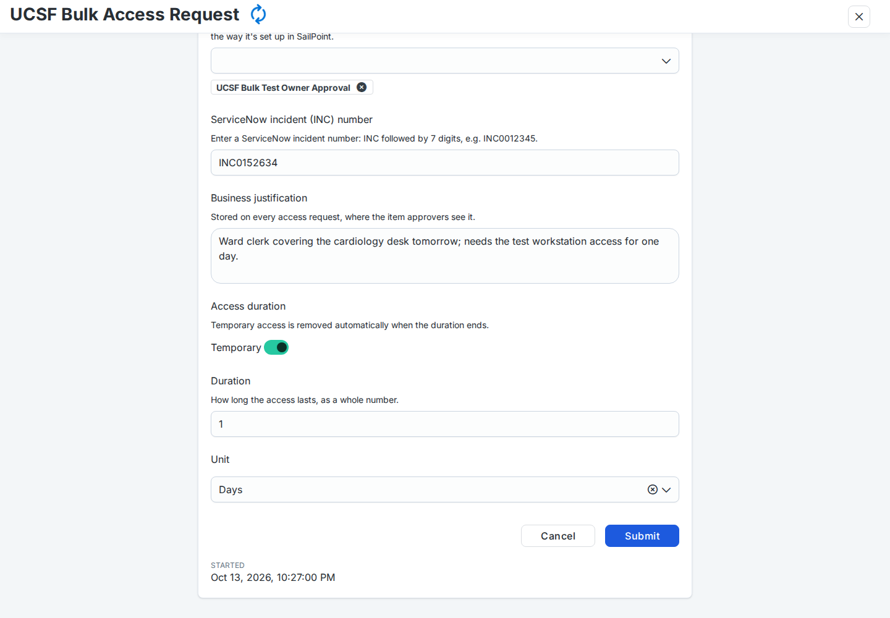

# Using Bulk Access Request

Guides for requesters, approvers and admins, following one bulk request from start to finish. The `isc-*` and
`launcher-*` screenshots are real SailPoint screens from a test installation that used the prefix `UCSF` (yours show your
own prefix): one bulk request, INC0151100, for four people and two test items, followed from submit to approval. The
`plugin-*` ones are the plugin with demo data, for what a small test tenant can't show (hundreds of people). They live in [docs/screenshots/](docs/screenshots/). For the same
lifecycle with the APIs and ISC features behind each step, see
[docs/sailpoint/END_TO_END_WALKTHROUGH.md](docs/sailpoint/END_TO_END_WALKTHROUGH.md).

There is no approval of the bulk request itself: each access request it files is approved the way its item is set up in
SailPoint (its owner, the person's manager, …), and an item with no approval of its own is granted right away.

| Step | Who | Where |
|---|---|---|
| [1. Get access to the tool](#1-get-access-to-the-tool-once) (once) | Requester | Request Center |
| [2. Submit a bulk request](#2-submit-a-bulk-request) | Requester | The plugin, or the Launchpad form |
| [3. Approve the items](#3-item-approvers-owners-managers) | Each item's approvers (owner, manager, …) | The plugin's **Approvals** tab, or ISC **Approvals → Access Requests** |
| [4. Follow it](#4-tracking-my-bulk-requests-and-the-request-center) | Requester | The plugin's **My bulk requests**, and the Request Center |
| [5. Emails](#5-emails-youll-get) | Requester (Launcher requests) | Your inbox: each email says what, why, and where to go next |

## 1. Get access to the tool (once)
Everyone who submits bulk requests, from the plugin or from the Launchpad, needs the access profile
**"<prefix> Bulk Access Request - Launcher Access"**. Approvers need nothing extra.

1. In the **Request Center**, search for *<prefix> Bulk Access Request*, select **Launcher Access**, **Continue**, add a
   comment and **Submit Request**.

   
2. It's approved automatically, or by your manager, depending on how your admin set it up (`access.launcherApproval`).
   **Request Center → My Requests** shows it as **Completed** once granted.

   
3. About a minute later the Launcher appears in your **Launchpad**, and the plugin lets you submit. Until then, a
   submit from the plugin stops with *"To submit, you need '<prefix> Bulk Access Request - Launcher Access'. Request it
   in the Request Center."* and nothing is sent.

   

## 2. Submit a bulk request
### From the plugin
Open **<prefix> Bulk Access Request** from the nav bar, or the plugin link your admin gave you. You don't need to be an
admin: the plugin files the access requests **as you**, so they carry your name and show in your Request Center.
(If your tenant doesn't let users request access for others, your admin will have set the plugin to go through the
Launcher instead; it then fills in and submits the Launcher's form for you.)

1. **People.** Search, or paste a list of usernames, emails or identity IDs (one per line). There's no upper limit
   unless your admin set one.

   
2. **Access.** Pick one or more items from the Request Center catalog. *Everyone* gets *every* item chosen here.
   Items SailPoint grants without any approval say so: *"No approval: granted right away"*.

   
3. **INC and details.** The ServiceNow INC number, a justification (up to 1,000 characters), and how long the access
   should last: **Permanent**, **for a duration** (a whole number and hours, days, weeks or months) or **until a date**
   (the end of that day, your local time). Your admin may turn some of these off, or cap how long temporary access can
   last.

   
4. **Review and submit.** The review says how many access requests SailPoint will file and how long the access lasts,
   warns about people who already have an item, and warns about items that have no approval of their own (everyone gets
   those as soon as they're requested). **Request access** (in dry-run mode: **Check it (dry run)**).

   
5. The page then says how many access requests it filed (and how many SailPoint skipped because the same request was
   already pending). Each one now goes through its item's own approval; follow them on **My bulk requests**.

   

**Big lists.** SailPoint takes at most 10 people per access request, so the plugin sends a long list as several requests
(a few at a time), all with the same INC, items, justification and access. If some can't be sent, the page lists them
and **Retry** sends just those again. Through the Launcher, a list above 250 people (your admin may set fewer) goes out
as several Launcher runs instead, shown on the review step; an end date then reaches the workflow as a number of hours.
(These two screens use demo data.)

| Temporary access | Review, through the Launcher in parts |
|---|---|
|  |  |

**When temporary access ends.** A duration counts from when you submit. An end date is the end of that day, your local
time. Either way the remove date is set on every access request, so a slow item approval doesn't move it.

### From the Launchpad form
**Launchpad → "<prefix> Bulk Access Request"** → **Launch**, and **Launch** again to confirm.

A form opens:

| Field | What to enter |
|---|---|
| **People who need the access** | Add up to 30 people. **Type the full username** (e.g. `Adam.Kennedy`): the picker only matches complete usernames. You can also scroll the list. |
| **Access to request** | One or more items. *Everyone* above gets *every* item chosen here. |
| **Access type** | **Permanent** (the default) or **Temporary**. Only shown if your admin turned temporary access on. |
| **Duration** and **unit** | For temporary access: a whole number of 1 or more, and hours, days, weeks or months (your admin may offer fewer units). |
| **ServiceNow incident (INC) number** | For example `INC0012345`. The form won't submit until the format is right. |
| **Business justification** | Shown to the item approvers and stored on every request |

The form checks the INC format when you submit:

| Filled in, temporary for 1 day | Submitted |
|---|---|
|  |  |

**Submit.** The Launchpad says the access was requested (in dry-run mode: checked), and you get a **Requested** email.
If the duration isn't valid (not a whole number, or longer than your admin allows), the Launchpad says so and nothing is
requested. The access requests are filed by the workflow, under its owner's name (see section 4).

## 3. Item approvers (owners, managers)
Each access request a bulk request files goes through the item's own approval scheme, **one approval per person**:
a bulk request for 300 people with an item you own gives you 300 approvals. They can arrive a minute or two apart.
Items with no approval scheme are granted without anyone's approval.

### In ISC: Approvals → Access Requests
One card per person. *Requested by* is the person who submitted from the plugin, or, for requests from the Launchpad
(or a plugin that goes through the Launcher), the **workflow owner** (the account the tool was installed with), because
the workflow files them. The card is titled **"Grant: <item>"**, or **"Modify: <item>"** when the person already has the
item and only its end date changes. The comment carries the INC, the requester, the access type and the justification:
`INC0055504 | Bulk access request by … | Temporary: 1 day | …`. (Requests filed while bulk requests still had their own
approver also carry `Approved by …` after the requester; the plugin reads both.)

### In the plugin: the Approvals tab
Open the **<prefix> Bulk Access Request** plugin and its **Approvals** tab to decide a whole bulk request at once. Any
approver can use it, admin or not (your admin must have made the plugin visible to you).

1. Each card is one bulk request: the **INC**, how many approvals, people and items, the access (permanent or temporary)
   and who asked for it.

   
2. Open a card to check the list. Untick anyone you don't want to decide now; they stay pending. Write one comment
   (needed to deny), then **Approve N** or **Deny N**.

   
3. Confirm. The dialog repeats the INC and the counts. You can only act on one INC at a time.

   
4. A progress bar shows the decisions going out (about 8 a second); each is then re-read, so "approved by you" only counts
   confirmed decisions. The result says **Approved** (or **Denied**) only when every one is confirmed as yours; otherwise
   **Decided** (some by someone else, such as a colleague in the same approval group), **Partly done** or **Not done**.
   **Retry** sends the failed and still-pending ones again.

   

   With many approvals (demo data):

   | Decisions going out | Partly done, with Retry |
   |---|---|
   |  |  |

Every decision is recorded as **yours**, exactly as if you had used SailPoint's Approvals page, and appears under
**Approvals → Access Requests → Reviewed**. Approvals that didn't come from a bulk request may be listed under *Other*
(if your admin turned that on); decide those in SailPoint as usual.

## 4. Tracking: My bulk requests and the Request Center
**Use the plugin's My bulk requests tab.** It lists the access requests you filed from the plugin, grouped by INC
(filter by INC at the top). Each INC shows how many people and items, how many are waiting, done or not granted, and
the justification; open it to see every person × item with its status (**Waiting for <approver>**, **Provisioning**,
**Done**, **Rejected**, …) and, for temporary access, **Temporary until …**. When SailPoint cancels one, it says why
(for example *Already has a pending request for this item*).

| Waiting for the item's approver | After the approval |
|---|---|
|  |  |

Because the plugin files the requests as you, they're also in your **Request Center → My Requests**, one per person and
item, with the INC in the comment.

**Requests from the Launchpad are different.** The Launcher's workflow files them, so SailPoint lists them under the
**workflow owner** (the account the tool was installed with), not under you: they're not in your Request Center or in
My bulk requests. You get a **Requested** email for each run instead.

| Who | What they see |
|---|---|
| **Requester** | Plugin requests: My bulk requests, and Request Center → My Requests. Launchpad requests: the *Requested* email. |
| **Workflow owner** (admin) | Request Center → My Requests: every request the Launcher's workflow filed, one per person and item, with the INC in its comment. **Completed** once provisioned; **Pending** while a source still needs manual work (for example a manual work item on a disconnected source). |
| **Item approvers** | Approvals → Access Requests → Reviewed, or the plugin's Approvals tab while pending. |

Temporary access is removed by SailPoint on its remove date, with no further action.

## 5. Emails you'll get
The Launcher's workflow emails the requester (requests from the Launchpad, or from a plugin that goes through the
Launcher). Requests the plugin files directly send no bulk email; SailPoint's own access-request notifications apply.
Every email has the same layout: **What** (the INC and part, each item with its type, how many people, permanent or
temporary), **Why** (the justification and who asked), and **What happens next** or **What to do now**, with links into
your tenant. A **Need help?** line at the bottom says whom to ask (`notifications.helpContact`).

| Email | When | Where it points |
|---|---|---|
| **Requested** | The access requests were filed | Each item is approved the way it's set up: item approvers use ISC **Approvals → Access Requests** or the plugin's **Approvals** tab. The requests are filed by the workflow, so they're not in your Request Center. |
| **Not requested** | The workflow stopped the request before anything was requested (a bad INC, a bad duration or unit, or longer than allowed) | The field to fix, what was entered, and where to submit again. The Launchpad (or the plugin) shows the same message at once. |

In `dry-run` mode the first one is **Checked** instead, with a **DRY RUN** banner: nothing is ever requested. With
`notifications.overrideRecipients` set (test tenants), all of them go to those addresses instead.

## Admins
- **Install, update, uninstall:** see [INSTALL.md](INSTALL.md). Everything is set in one file, `config/<tenant>.json`.
  - Check health: `python bulkaccess.py status --config …`.
  - After any config change, or when the catalog changes: `python bulkaccess.py apply --config …`.
- **Who can use it:** whoever holds the *Launcher Access* profile. It's an ordinary access profile, so it shows up in
  certifications too, and people request it in the Request Center (auto-approved with `access.launcherApproval: "NONE"`,
  else by their manager). The plugin checks the same profile before it submits. People must also be able to see the
  plugin (make it public, or add them to its `restrictToUsers`); its Approvals tab works for any item approver who can
  see it. Item approvers need nothing extra.
- **How the plugin submits** (`plugin.submit`): `direct` (the default) files the access requests as the signed-in user,
  which needs *Request for others* allowed in Access Request Settings; `launcher` goes through the Launcher's form.
  `apply` switches to `launcher` by itself when the tenant doesn't allow requesting for others.
- **Items without an approval:** `apply` lists every catalog item SailPoint would grant without approval (it prints
  how many), and the plugin warns about them. Give an item an approval scheme if it needs one, then run `apply` again.
- **The workflow owner is the requester of every Launcher request** (`owner` in the config, or the installer's PAT user).
  Item approvers see that account as *Requested by*, and its Request Center lists those requests. A dedicated service
  identity that owns and approves no items keeps this tidy.
- **Approvals tab** (`approvals` in the config): on by default. `concurrency`, `useBulkEndpoint` (`auto` = SailPoint's bulk
  endpoint for ORG_ADMIN only; it refuses everyone else), `maxRows`, `showOther` and `denyCommentRequired`.
- **Temporary access** (`temporaryAccess` in the config): turn it on or off, choose the units, allow end dates (plugin
  only), and cap the length with `maxDays`. It ends automatically on the remove date, and SailPoint removes it with no
  further action. The remove date is visible on each access request.
- **Audit:**
  - Every request made by the tool has this comment:
    `INC… | Bulk access request by <requester> | <access> | <justification>`,
    where `<access>` is `Permanent` or `Temporary: …`. The INC always comes first. (Requests from before the bulk
    approver was removed also carry `Approved by <approver>` after the requester.)
  - Each request's approvals are in its access-request history (who approved, when). Search for the INC to find all
    the requests of one bulk request.
  - Each Launcher run is in **Admin → Workflows → "<prefix> Bulk Access Request" → Execution History** (the plugin's
    runs are there too when it submits through the Launcher).
- **Test safely:**
  - Keep `"mode": "dry-run"` until you've run `launcher/e2e.py` on test identities, and checked which catalog items
    have no approval of their own (`apply` prints how many; the plugin labels them).
  - In shared or test tenants, set `notifications.overrideRecipients` so emails don't reach real people.
