# End-to-end walkthrough: one bulk request on a real tenant

**For SailPoint and platform teams.** One bulk request followed from start to finish: who acts, where in ISC, what they
see, and which ISC feature or API call does the work.

**Since 2026-10-13 there is no bulk approver.** Nothing asks one person to approve the request as a whole: each item
is approved the way SailPoint has it set up (its owner, the person's manager, …), and items with no approval of their
own are granted right away. The plugin files the access requests itself, as the signed-in user
(`plugin.submit: "direct"`, the default).

About the pictures:
- The **ISC screens** (`isc-*`, `launcher-*`) are from a live run on 2026-10-13 on a test tenant (prefix `UCSF`):
  INC0151100, submitted from the plugin by `bulk.requester.test` for four people and two test items (one granted
  without approval, one approved by its owner `bulk.approver.test`), and INC0152634 from the Launchpad.
  (`isc-02` is from the first recording, 2026-10-08.)
- The **plugin screens** (`plugin-*`) come from the plugin's demo mode (made-up data, prefix `ACME`), for what a test
  tenant can't show (hundreds of people).

Related: [API_INVENTORY.md](API_INVENTORY.md) (every call, with user levels and scopes) ·
[REQUIREMENTS_CHECKLIST.md](REQUIREMENTS_CHECKLIST.md) (what to check in a tenant first) ·
[USAGE.md](../../USAGE.md) (the same steps, written for end users).

## The cast
| Role | Example | User level | Needs |
|---|---|---|---|
| **Requester** | `bulk.requester.test` | User (not an admin) | The *"<prefix> Bulk Access Request - Launcher Access"* profile, and to see the plugin |
| **Item approver** (for example the owner of an access profile, or the person's manager) | `bulk.approver.test` | User | Nothing (to see the plugin, for its Approvals tab) |
| **People** getting the access | Test identities | — | — |
| **Workflow owner** (Launcher only) | The admin who installed the tool (the PAT user), or the configured `owner` | ORG_ADMIN | Already set up by the installer |

The request: a few people × one or more items, optionally temporary, with an INC number.

## At a glance
| # | Who | Where | ISC feature | Main API calls |
|---|---|---|---|---|
| 1 | Requester | Request Center | Access request for a requestable access profile | ISC's own |
| 2 | Requester | Launchpad | Launcher (`assignedLaunchers` entitlement) | ISC's own |
| 3 | Requester | The plugin | UI plugin, access requests | `public-identities/v1`, `requestable-objects/v1?identity-id=`, `entitlements/v1`, `POST access-requests/v1` |
| 3b | Requester | Launchpad, or the plugin in launcher mode | Launcher, interactive form, workflow | `launchers/v1/{id}/launch`, `/beta/interactive-processes/{id}/blocks`, `form-instances/v1/{id}`; `sp:loop:iterator`, `sp:access:manage` v2 |
| 4 | Item approvers | Approvals → **Access Requests**, or the plugin's Approvals tab | Access-request approvals (one per person and item) | `generic-approvals/v1?mine=true`, `generic-approvals/v1/{id}/approve` |
| 5 | Requester | Plugin *My bulk requests*, Request Center *My Requests* | — | `access-request-status/v1?requested-by=<me>` |

## 1. The requester gets Launcher Access (once)
**Who:** the requester. **Where:** Request Center.

The installer created the access profile *"<prefix> Bulk Access Request - Launcher Access"*. It wraps the
`assignedLaunchers` entitlement that ISC auto-creates for the Launcher on the IdentityNow source, and it's requestable.
The requester finds it in **Request Center → Find Access**, selects it, adds a comment and submits.

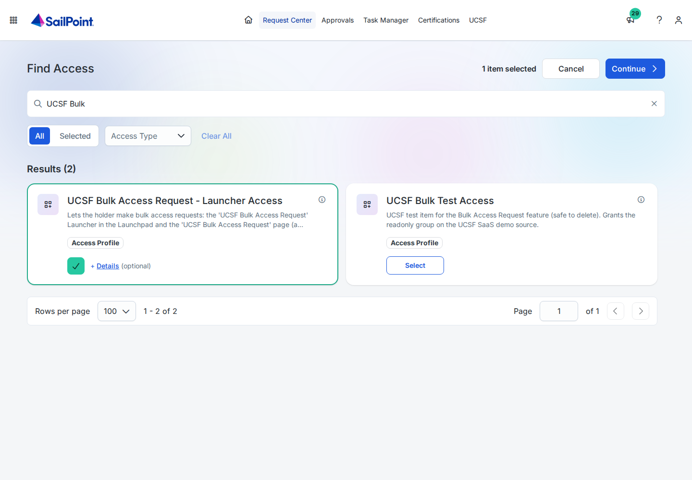

It's **auto-approved** when `access.launcherApproval` is `NONE` (as in the recording), otherwise it goes to the
requester's **manager**. **Request Center → My Requests** then shows *Grant: … Launcher Access* as **Completed**.

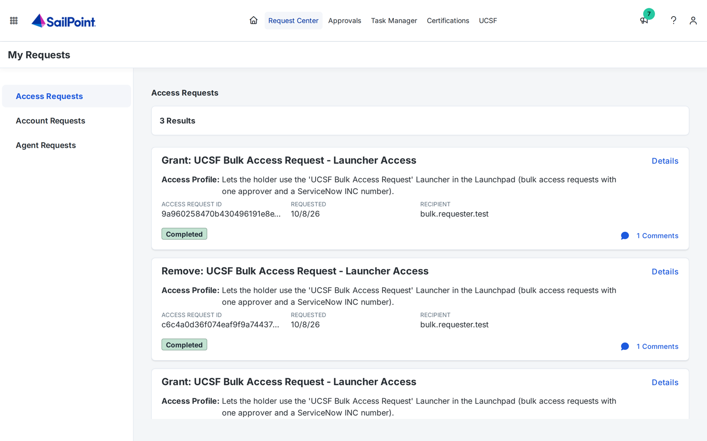

The same profile decides who may submit from the plugin. **Without it**, the plugin can still be opened, but a submit
stops before anything is sent: *"To submit, you need '<prefix> Bulk Access Request - Launcher Access'. Request it in
the Request Center."* The page checks it with
`GET /requestable-objects/v1?identity-id=<me>&types=ACCESS_PROFILE&filters=id eq "<profile id>"` (`requestStatus:
ASSIGNED`), a call any user may make for themselves.

## 2. The Launcher appears in the Launchpad
**Who:** the requester. **Where:** Home → Launchpad.

About a minute after the grant, the Launcher *"<prefix> Bulk Access Request"* is listed in the Launchpad. Launching it
there opens the native form (up to 30 people; see 3b). The plugin is the better way for bigger requests.

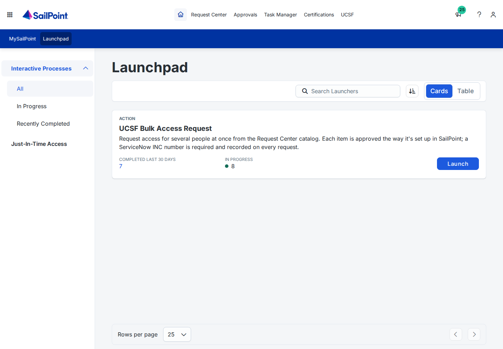

## 3. The requester submits from the plugin
**Who:** the requester (not an admin). **Where:** the *<prefix> Bulk Access Request* UI plugin, inside ISC.

| Step | What they do | Calls (as the signed-in user) |
|---|---|---|
| People | Search by name, or paste usernames, emails or IDs (any number) | `GET /public-identities/v1` (non-admins); admins use identities, search and accounts |
| Access | Pick from the Request Center catalog. Items with no approval of their own are labelled **"No approval: granted right away"** | `GET /requestable-objects/v1?identity-id=<me>&types=…`, `GET /entitlements/v1?filters=requestable eq true`. The no-approval list is in the runtime config, worked out by the installer |
| INC & details | The INC (checked against the configured pattern), a justification (≤ 1000 characters), and optionally temporary access (*For a duration* or *Until a date*) | — (rules run in the page) |
| Review | Checks "already has it" for access profiles and roles, and warns about items that will be granted without approval | `GET /requestable-objects/v1?identity-id=<person>&filters=id in (…)` |

| People | Access |
|---|---|
| 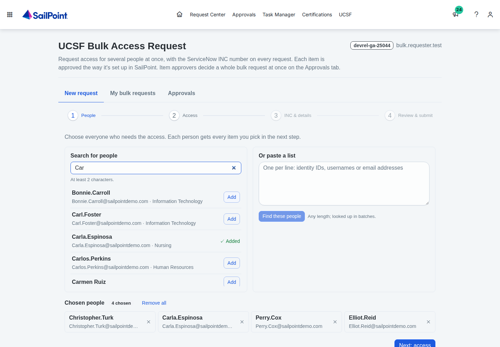 | 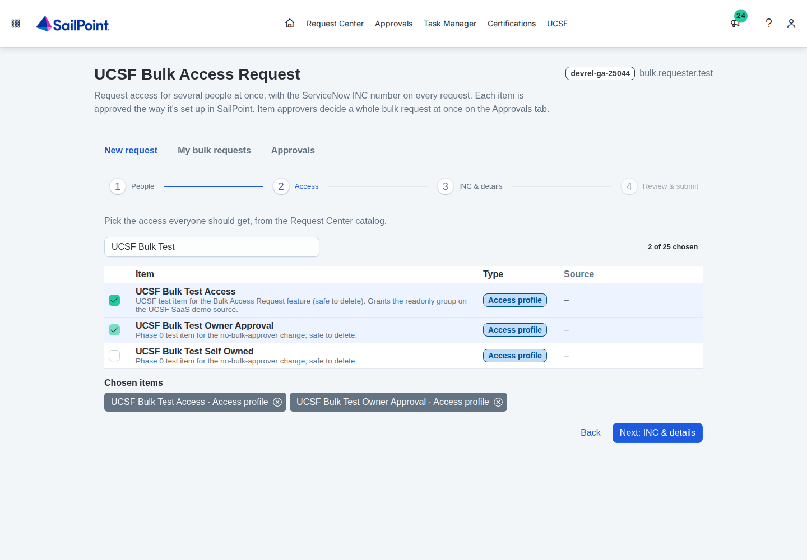 |
| **INC & details** | **Review: the no-approval and "already requested" warnings** |
| 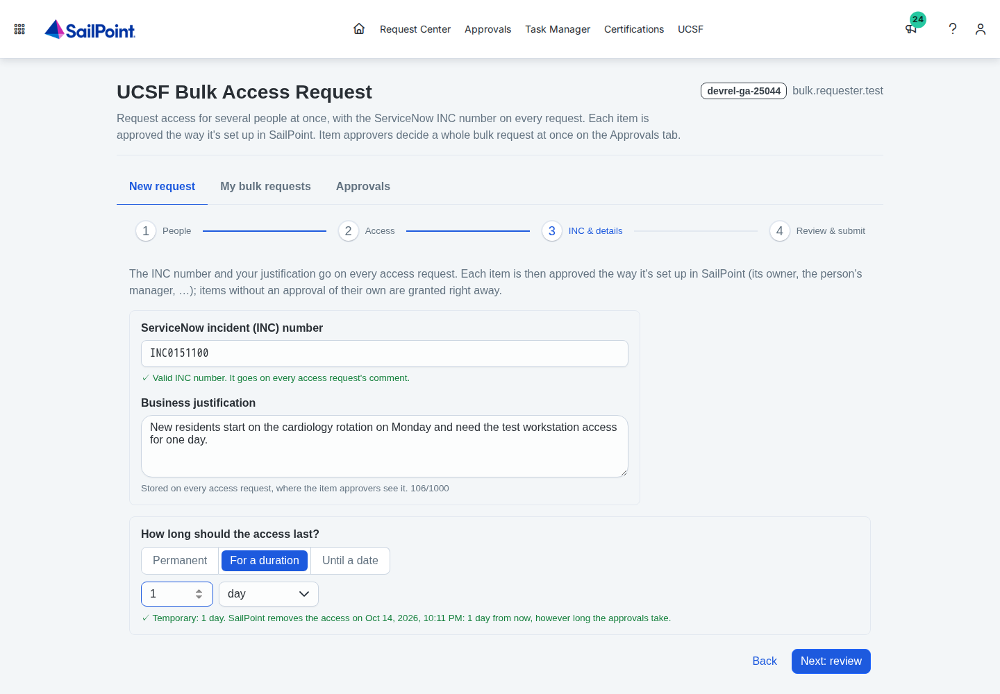 | 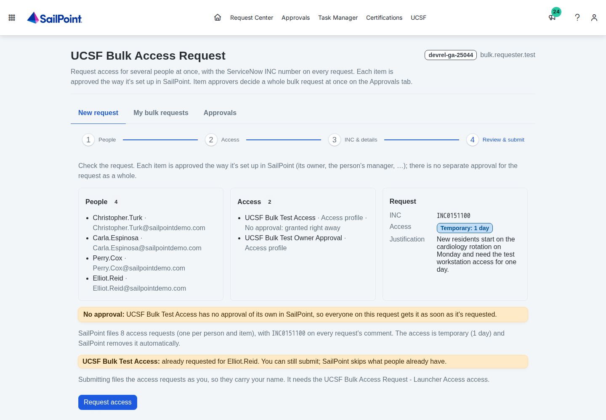 |

**Request access** then:

1. Checks the requester holds *Launcher Access* (section 1).
2. Files the access requests **as the signed-in user**: `POST /access-requests/v1`, one call per 10 people (SailPoint's
   limit per request), up to 3 at a time. Each call carries every chosen item, and each item carries:
   - the comment `INC0048391 | Bulk access request by <requester> | <access> | <justification>`, and
   - for temporary access, a `removeDate` (now + the duration, or the end of the chosen day).
3. Shows how many requests were filed, and how many SailPoint skipped because the same request was already open.

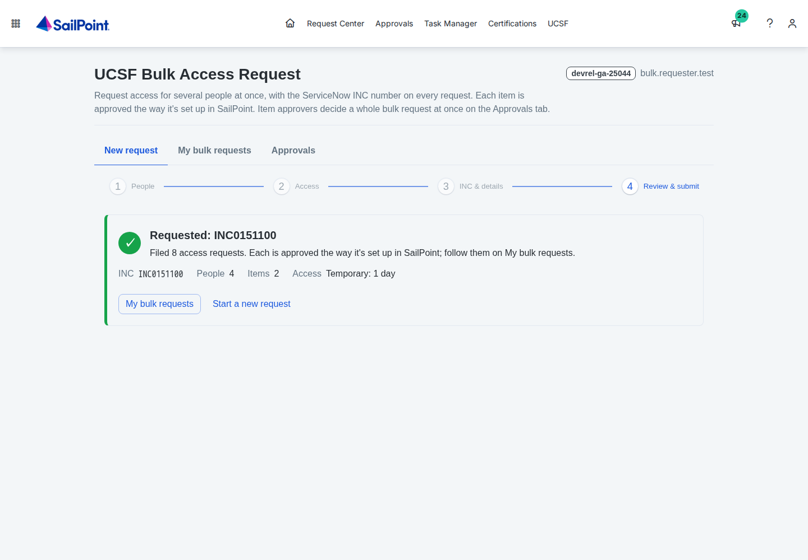

Elliot.Reid already had a pending request for the no-approval item, so SailPoint listed his request in `newRequests` but
cancelled it at once (*"Already has a pending request for this item"*); the review step had warned about it.

A failed call is shown per part and can be retried on its own; a 401/403 stops the rest (the tenant may not let this
user request access for others, or the session expired). In `mode: "dry-run"` nothing is sent.

**Who is the requester?** The requests are filed with the signed-in user's own session, so ISC records them as the
requester: on the request, in the approvers' *Requested by*, and in the requester's own *My Requests*. If the requester
is also an item's approver, ISC hands that approval to an administrator (its own self-approval rule).

**The tenant must allow it:** *Admin → Global → Access Request Settings → Request for others* (the API's
`requestOnBehalfOfConfig.allowRequestOnBehalfOfAnyoneByAnyone`). The installer reads it; when it's off, the plugin is
installed in launcher mode instead (3b).

## 3b. Through the Launcher instead (Launchpad, or `plugin.submit: "launcher"`)
The Launcher's form asks for the same things (people, items, INC, justification, temporary access) and has no approver
field. Its workflow *"<prefix> Bulk Access Request"* (triggered by `idn:interactive-process-launched`, filtered to its
own Launcher):

1. checks the INC against the pattern, and the duration and unit (and `temporary.maxDays`);
2. on a failed check, shows an ERROR message in the Launchpad (*"Invalid INC number"*, …), emails *"Not requested: …"*,
   and stops: nothing is requested;
3. otherwise shows *"Requested: INC…"* and, in `live` mode, loops over the people (`sp:loop:iterator`, ≤ 250 per run,
   in parallel) and files one access request per person with all the items (`sp:access:manage` v2, `removeDuration`
   `"1d"` etc., `""` = permanent), with the same comment as above;
4. emails the requester *"Requested: bulk access INC…"* (dry run: *"Checked: … (DRY RUN: nothing was requested)"*).

| Launch | The form |
|---|---|
| 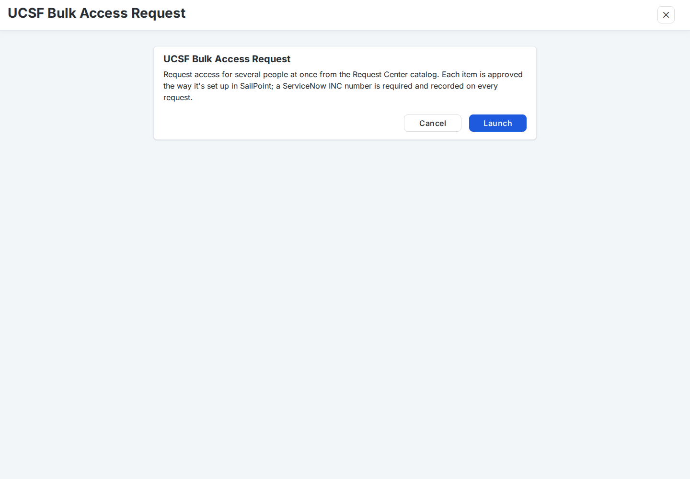 | 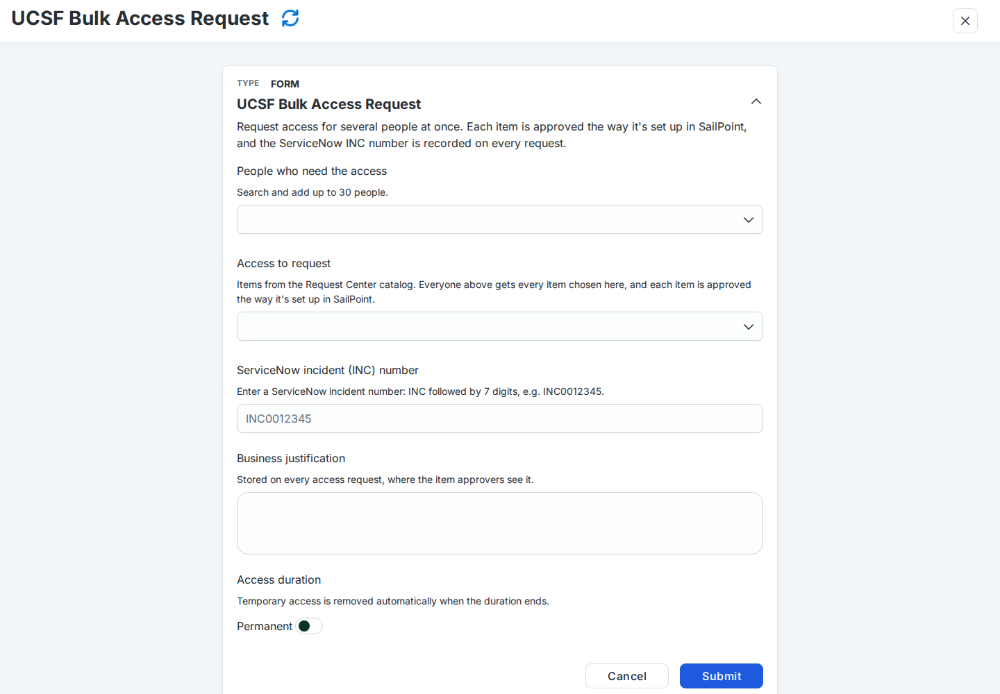 |
| **INC checked on Submit** | **Requested** |
| 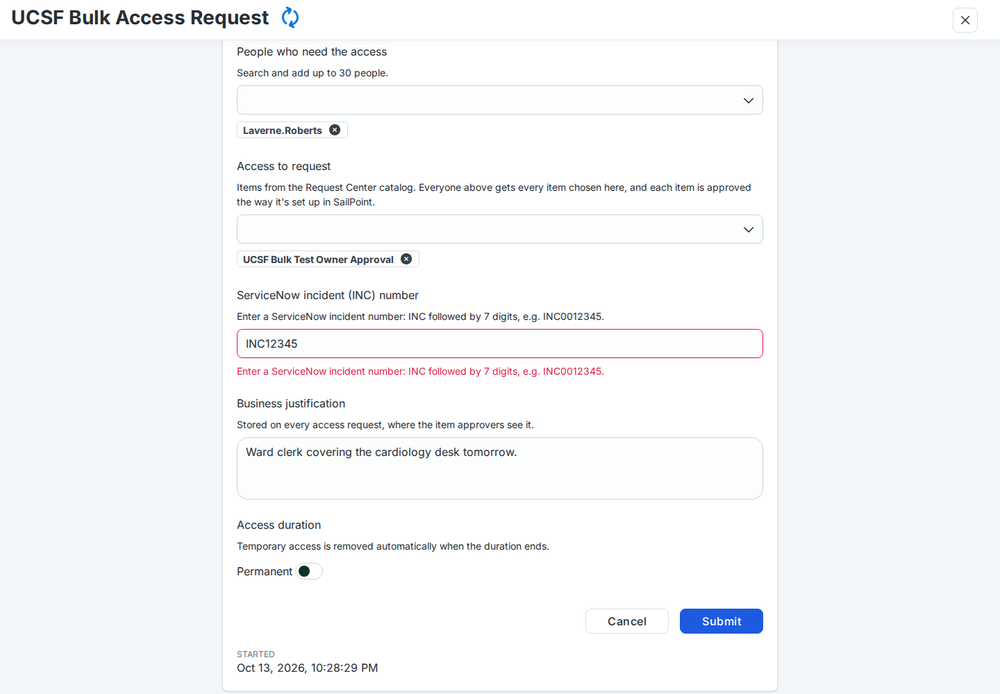 | 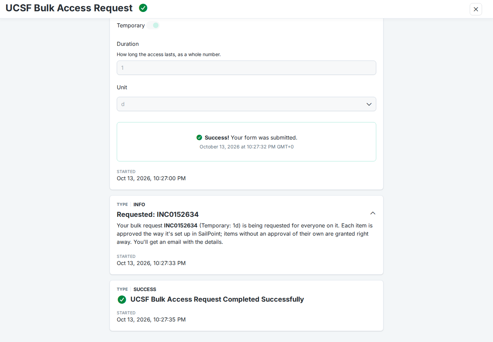 |

In launcher mode the plugin drives the same Launcher as the signed-in user, once per part of up to 250 people:
`POST /launchers/v1/{id}/launch` → `GET /beta/interactive-processes/{id}/blocks` until the `FORM` block appears (the
same **beta** call ISC's Launchpad makes; see the risk in
[API_CONTRACT_ALIGNMENT.md](API_CONTRACT_ALIGNMENT.md#5-risks-and-what-to-watch)) → `PATCH /form-instances/v1/{id}`
(`/formData`, then `/state` = `SUBMITTED`) → the blocks again, for the workflow's INFO or ERROR message.

**The difference that matters:** the workflow files the requests as **its owner** (the installer's PAT user, or the
configured `owner`), not as the requester. So *Requested by* shows the workflow owner, the requester doesn't see the
requests in *My Requests* or the plugin's *My bulk requests*, and an item whose approver is the workflow owner is
escalated to an admin. A dedicated service identity as `owner` keeps this separate from a real admin.

## 4. Item approvers decide, in ISC or in the plugin
**Who:** each item's approvers. **One approval per person and item**, exactly as for any other access request; a
second person's approval can arrive **1–2 minutes** after the first. Items with no approval of their own are granted
straight away and never reach this step.

**In ISC, Approvals → Access Requests:** one card per person and item. The title is **"Grant: <item>"**, or
**"Modify: <item>"** when the person already had the item and only the end date changes (the drawer then reads
*Access Date Change*). The comment carries the INC, the requester, the access type and the justification.

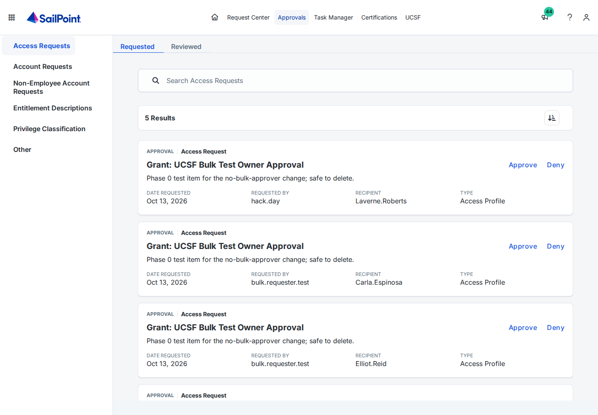

**In the plugin's Approvals tab:** the approver's pending access-request approvals, grouped by the INC in their comment
(`GET /generic-approvals/v1?mine=true&include-comments=true&filters=status eq "PENDING" and type eq "ACCESS_REQUEST_APPROVAL"`).
One comment and one confirmation decide the whole INC; each approval is sent as the approver's own decision
(`POST /generic-approvals/v1/{id}/approve`, about 8 a second) and then re-read to confirm it. Approvals from before
2026-10-13 (whose comment still has *"Approved by …"*) group the same way.

| Grouped by INC | Opened: every person × item, one comment |
|---|---|
|  | 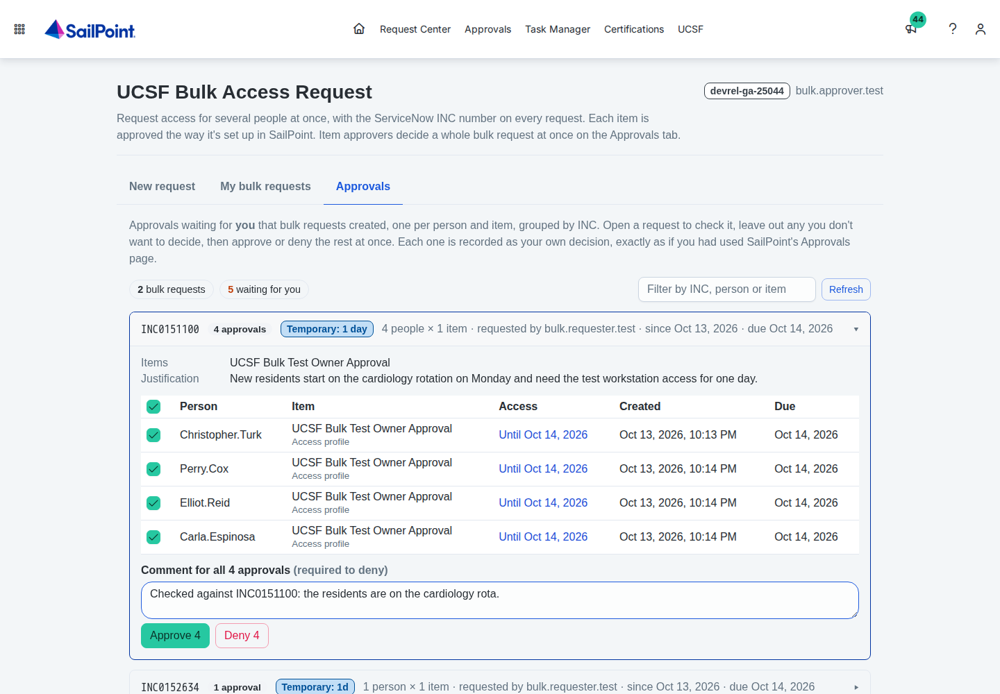 |
| **Confirm** | **Result: 4 approved by you** |
| 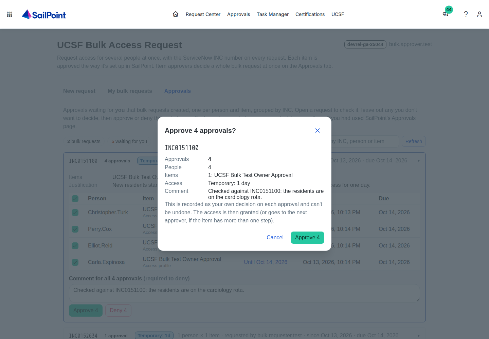 |  |

The decisions are recorded exactly as if made in ISC's Approvals page, and appear under **Access Requests → Reviewed**.

## 5. Following the request
| Who | Where | What they see |
|---|---|---|
| **Requester** (direct mode) | Plugin *My bulk requests* | Their access requests grouped by INC: per request its status (*Waiting for <approver>*, *Provisioning*, *Done*, *Rejected*), and *Temporary until …*. From `GET /access-request-status/v1?requested-by=<me>`, whose rows carry `approvalDetails[].currentOwner` |
| **Requester** (direct mode) | Request Center *My Requests* | The same requests, filed in their name |
| **Requester** (launcher mode) | Email | *"Requested: bulk access INC…"*. The requests belong to the workflow owner, so they're not in the requester's lists |
| **Item approvers** | Approvals → Access Requests, or the plugin's Approvals tab | Their own approvals, then *Reviewed* |
| **Workflow owner** (launcher mode) | Request Center *My Requests* | One request per person, with the INC in the comment |

| My bulk requests: waiting for the item's approver | After the approval | Request Center, My Requests |
|---|---|---|
| 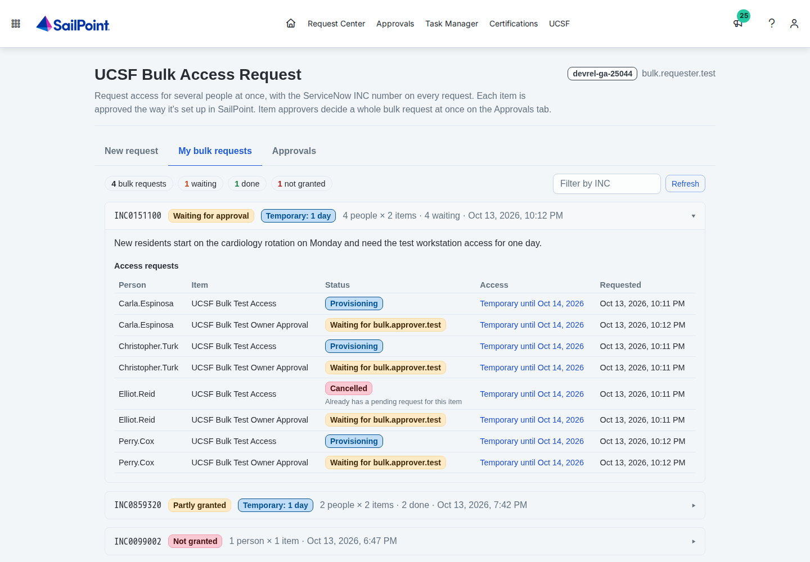 | 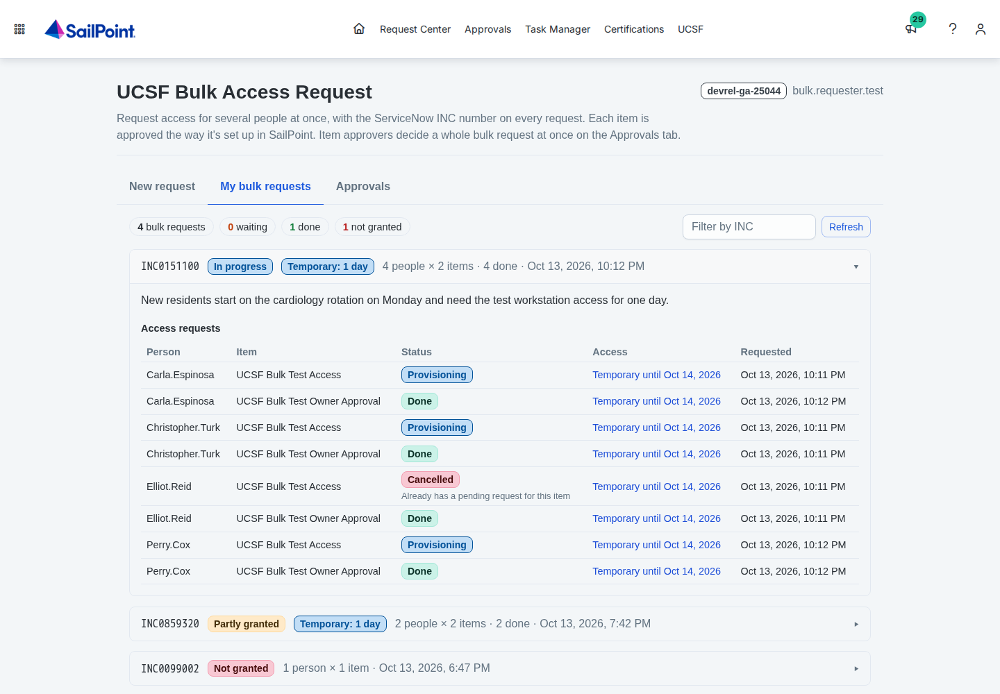 | 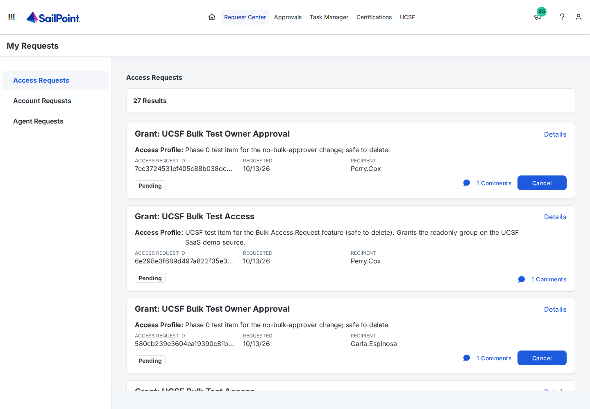 |

**For audit, search the INC:** it's on every access request's comment (and, in launcher mode, in the workflow's
execution history and its emails).

### Emails
- **Direct mode:** the plugin sends no email of its own; ISC's usual access request notifications apply.
- **Launcher:** the requester (or `notifications.overrideRecipients`) gets *"Requested: bulk access INC…"* after the
  checks, or *"Not requested: …"* with the field to fix. Links come from `config.ui_base_url` (the `SAIL_BASE_URL` host
  without `.api.`, or `notifications.uiBaseUrl`) and the plugin's ID from `GET /ui-plugins/v1/resolve-alias`.

## 6. Temporary access ends on its own
The requests carry `removeDate` (direct) or `removeDuration` (Launcher). SailPoint removes the access then, with no
further action; the plugin's *My bulk requests* shows **Temporary until …** on each request.
