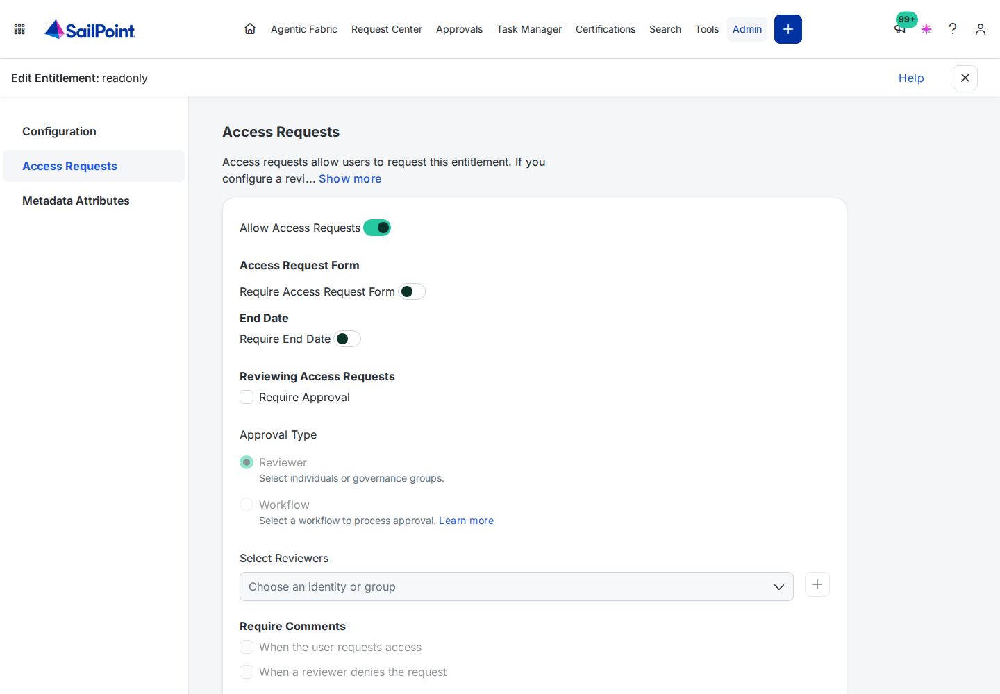
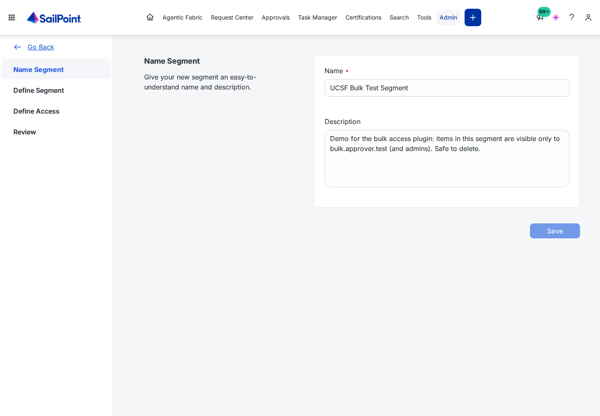
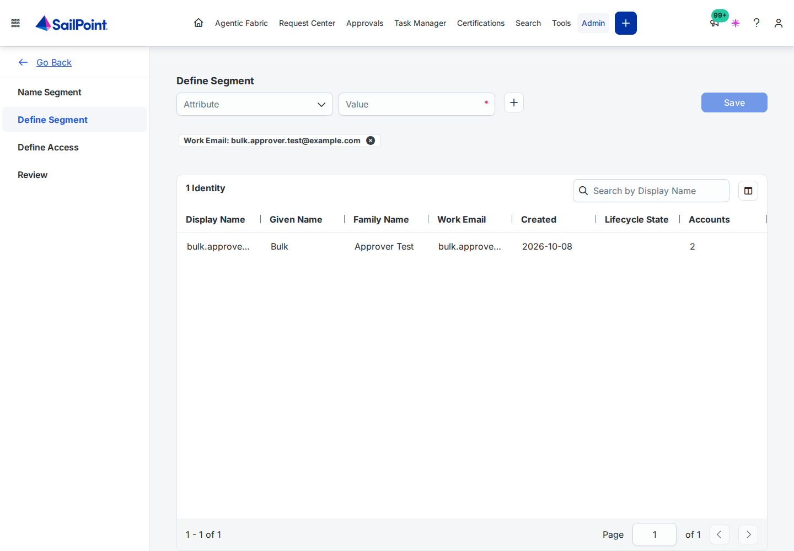
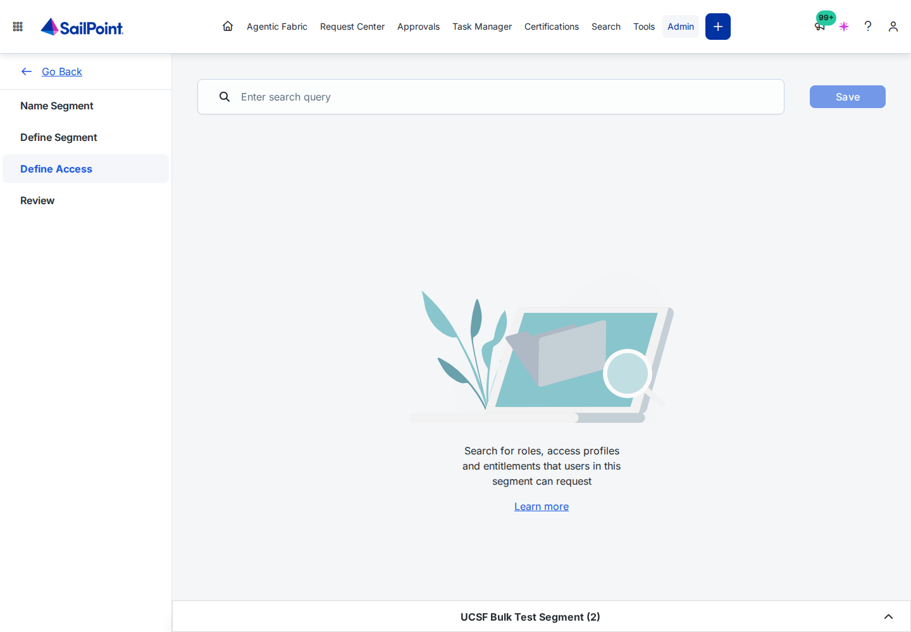
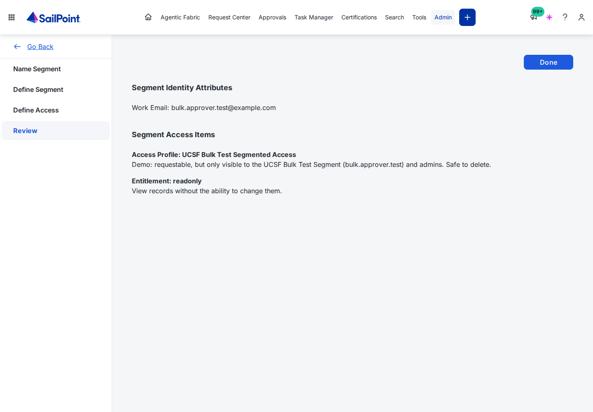
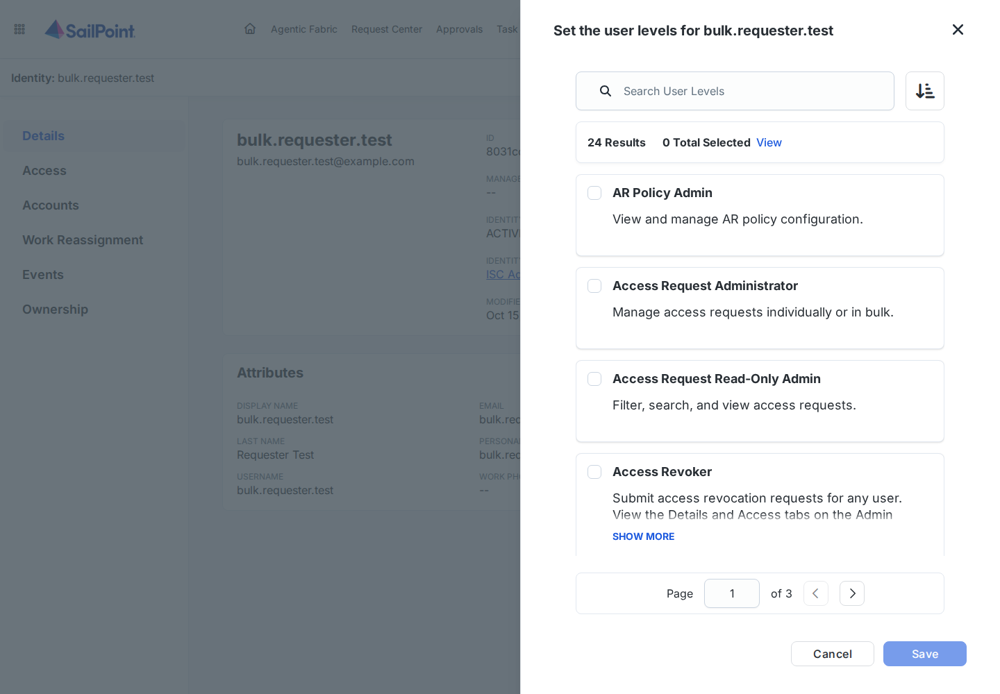
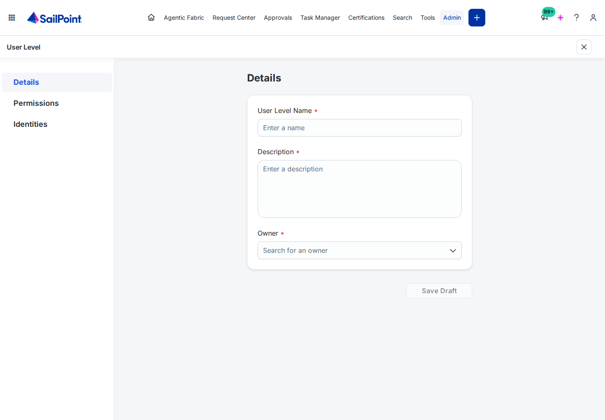

# Restricted access: segments and user levels

How to let **chosen people** request access that everyone else can't, for example a privileged AD group, and how to
use SailPoint **user levels** to control who may set this up. Everything here is done in the ISC admin UI; nothing in
the bulk tool has to change. Behaviour marked *verified* was tested in the demo tenant on 2026-10-14 and 2026-10-15.

## 1. Why "not requestable" isn't enough

SailPoint refuses a request for an item that isn't requestable, **for everyone**: an ORG_ADMIN, the access request API,
and a workflow's Manage Access step all get *"The following access items are not requestable"* (verified). So there's no
admin-only back door, and the bulk tool can't offer one.

The SailPoint way is: make the item **requestable**, then hide it with an **access request segment** so only the people
in the segment can request it.

## 2. How segments behave (verified)

| | Access profile or role in a segment | Entitlement in a segment |
|---|---|---|
| Hidden from people outside the segment | Yes | **No**: `/entitlements/v1` (the plugin's entitlement list) shows it to everyone |
| Request refused when someone outside the segment submits it anyway | Yes: 403 *"The current user is not allowed to request this item due to lack of segment membership"* | **No**: the request is accepted |

What follows from that:

- **Put groups in an access profile, and segment the access profile.** Never rely on a segment on the entitlement itself.
  Leave the group entitlement *not requestable*; the access profile is the only way to request it.
- **The segment decides who may *request*.** When submitting, SailPoint checks the **requester's** membership: someone
  outside the segment is refused even when requesting for a member, and a member may request the item **for anyone**,
  including people outside the segment (verified). So the segment lists the requesters (for example the service desk),
  not the people who receive the access.
- **The catalog follows the person it's shown for.** `requestable-objects?identity-id=<X>` lists the item only when X is
  in the segment. The plugin lists its catalog for the signed-in requester, so segment members see the item and others don't.
- **Admins aren't exempt.** An ORG_ADMIN outside the segment doesn't see the item either. If admins need it, include them
  in the segment's criteria.
- **It takes about 5 minutes** after saving before the catalog reflects a segment change.
- **A segment only applies while it's enabled** (the *Enabled* column on the Segments page).

## 3. Set it up in the UI

You need the **Admin** user level (ORG_ADMIN) for step 3: SailPoint offers no way to delegate segment management
(section 4).

### Step 1: decide how to recognise the requesters

A segment matches **identity attribute values**. Pick an attribute that marks exactly the people who may request the
restricted access, for example `department`, or a dedicated identity attribute (such as "Privileged Requester",
mapped in the identity profile from an HR or AD field). A dedicated attribute is easier to audit than a list of emails.

### Step 2: wrap the group in a requestable access profile

1. **Admin → Access Profiles → Create New.** Give it a clear name, an owner, the group's source, and the group
   entitlement.
2. In its access request settings, make it **requestable** and choose its **approval** (for example the access
   profile owner). The bulk tool uses exactly this approval for every request (each item is approved the way it's set
   up in SailPoint).
3. Keep the group entitlement itself **not requestable**: **Admin → Entitlements →** the entitlement **→ Edit → Access
   Requests**, *Allow Access Requests* off.

### Step 3: create the segment

**Admin → Segments → New** opens a four-step editor:

1. **Name Segment:** a name and a description that says who is in it and why.

   
2. **Define Segment:** choose an **Attribute**, enter the **Value**, and click **+**. The table underneath shows every
   identity that matches, so check the count and names before you continue. Add your admins if they need the item too.

   
3. **Define Access:** search for the **access profiles** (and roles) these people may request, and add them. Don't add
   entitlements (section 2).

   
4. **Review**, then **Done**.

   

Then open the segment from the list and check *Enabled* is **Yes**. *Search and View Segment Identities* on the same page
shows who is in it.

*(Screenshots from the demo tenant's test segment, edited without saving.)*

### Step 4: check it

After about 5 minutes:
- **As someone in the segment:** the access profile appears in the Request Center and in the bulk plugin's catalog, and can
  be requested for anyone.
- **As someone outside it:** it's in neither, and a request for it is refused.

## 4. User levels: who may do what

A **user level** controls what someone may do in the admin UI and API. Assign one under **Admin → Identities →** the
person **→ Actions → Set User Levels** (tick the levels, **Save**). The person's *USER LEVELS* field then lists them.

Who can do each part of this setup:

| Task | Built-in user levels that can | Custom user level right set |
|---|---|---|
| Create, edit, enable or delete **segments** | **Admin** only (the API requires ORG_ADMIN) | none: it can't be delegated |
| Make an **entitlement** requestable or not | Admin, Source Admin | *Entitlements Management* (not tested) |
| Create or edit the **access profile** that wraps the group | Admin, Source Admin, Role Admin; Source Sub-admin and Role Sub-admin for the sources of their governance groups | *Access Profiles Management* |
| Create or edit **roles** | Admin, Role Admin, Role Sub-admin | *Roles Management* |
| View, search and manage **access requests** | Access Request Administrator; read only: Access Request Read-Only Admin | none |
| **Revoke** access for anyone | Access Revoker | none |

The rest isn't a user level:

| Who … | Decided by |
|---|---|
| may **request** the restricted item | membership of the **segment** (section 3) |
| may use the **bulk tool** | the requestable role *"&lt;prefix&gt; Bulk Access Request - Submit Access"* |
| **approves** each request | the access profile's approval setup |

### Custom user levels

When a built-in level gives too much, build your own from **right sets**:

1. **Admin → User Levels → New User Level.**
2. **Details:** *User Level Name*, *Description* and *Owner* (all required), then **Save Draft**.
3. **Permissions:** pick the right sets, for example *Access Profiles Management* plus *Entitlements Read Only* for
   someone who wraps groups in access profiles but doesn't change entitlements.
4. **Identities:** add the people who get it, then publish it.

The tenant lists 40 right sets. These are the ones that matter here:

| Right set | What it allows |
|---|---|
| Access Profiles Management / Read Only | Create, view, manage and delete access profiles, or view only |
| Entitlements Management / Read Only | View and manage entitlements, or view only |
| Roles Management / Read Only | Create, view, manage and delete roles, or view only |
| Identity Read Only | View identities |
| IDN Governance Group Membership Management | Manage governance group members (e.g. groups used as approvers) |

There's no right set for segments, so segment management stays with Admin. The custom user level API
(`/authorization/custom-user-levels`) is still **experimental** (`X-SailPoint-Experimental: true`), so manage them in
the UI.

## 5. A model that keeps this tight

| People | What they get |
|---|---|
| One or two **segment owners** | Admin. Keep this list short: Admin can do everything, including changing segments. |
| **Access stewards** who wrap groups in access profiles | A custom user level with *Access Profiles Management* (and *Entitlements Management* only if they also switch requestability) |
| **Privileged requesters** (e.g. the service desk) | The identity attribute that puts them in the segment, plus the *Submit Access* role if they use the bulk tool |
| **Approvers** | Named as the access profile's approver (owner, governance group, …) |
| Auditors | *Access Request Read-Only Admin* |

Review the segment's members (*Search and View Segment Identities*) and the access profile's holders in your regular
certifications.

## 6. With the bulk tool

- **Plugin:** nothing to configure. It lists access profiles and roles as the signed-in requester, so segment members see
  the restricted access profile and others don't, and SailPoint enforces the same rule when they submit. Re-run
  `bulkaccess.py apply` after adding an access profile only to refresh the *"No approval: granted right away"* labels.
- **Don't segment entitlements:** the plugin lists requestable entitlements to everyone (`/entitlements/v1` ignores
  segments), and SailPoint doesn't enforce the segment on them.
- **"Already has it" warnings:** for a person outside the segment, SailPoint returns no catalog row for the restricted
  access profile, so the plugin can't warn that they already hold it. SailPoint then cancels that one request
  ("Already has access to this item…"), which *My bulk requests* shows.
- **Launchpad form:** its item list is built when it's installed and shown to everyone, and its workflow files the requests
  as the workflow owner. Don't offer segmented access through the Launcher; use the plugin.
